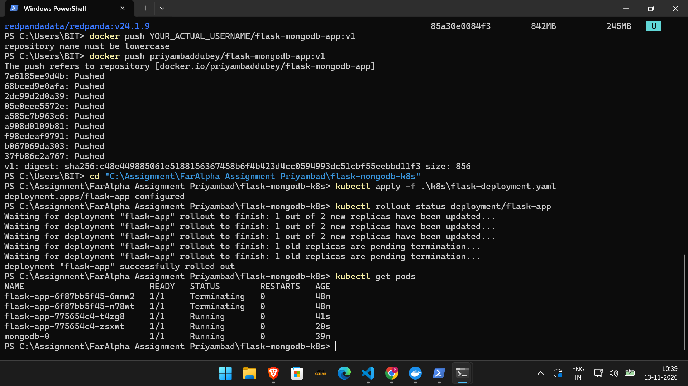
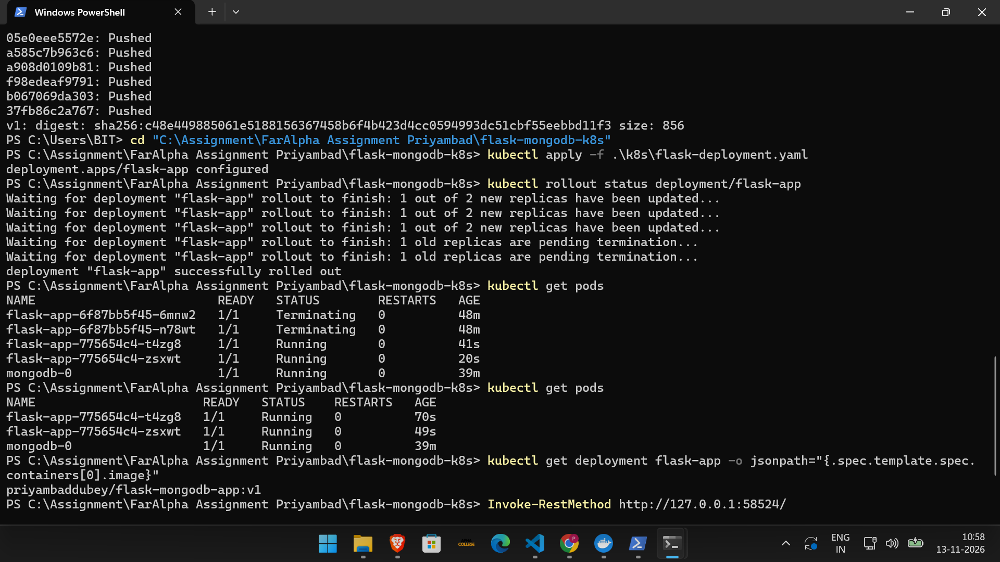
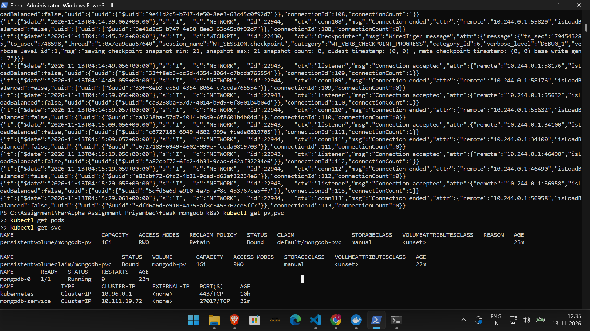
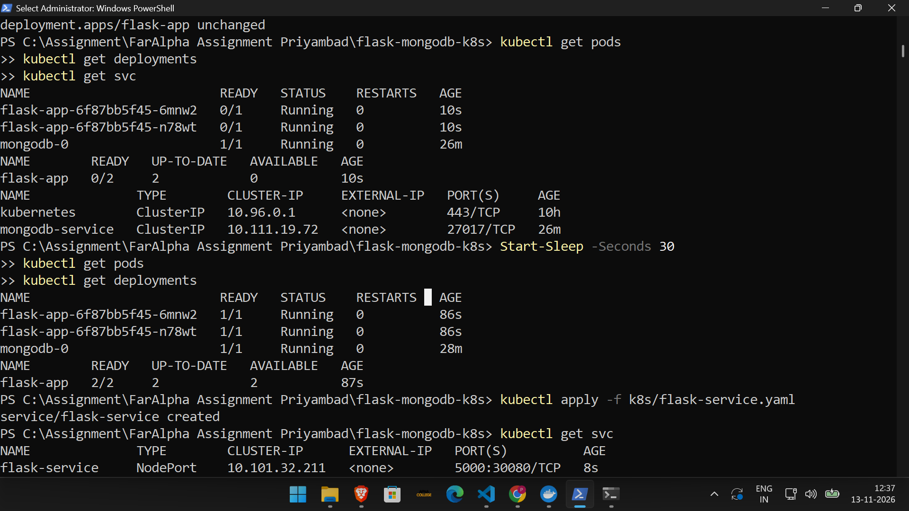
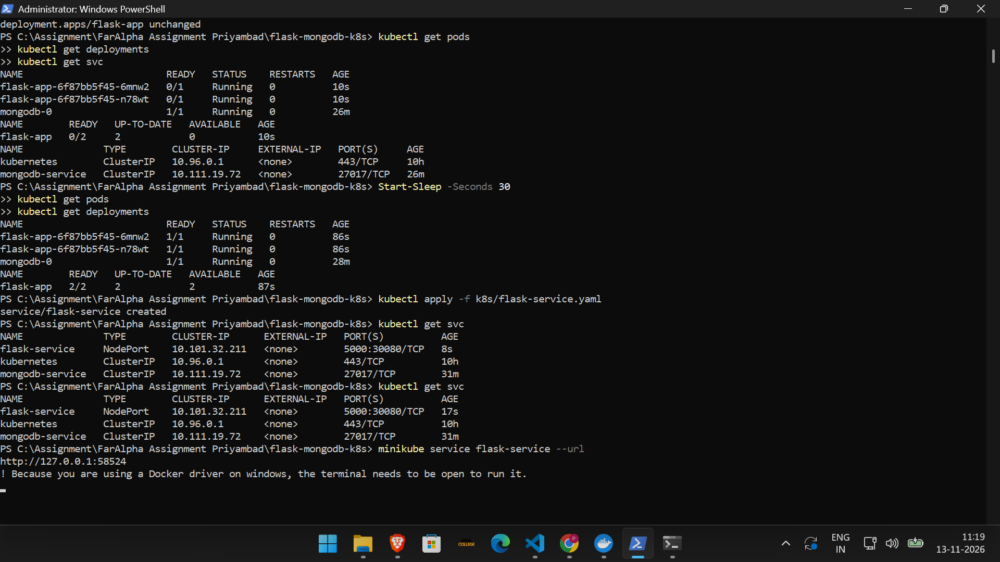
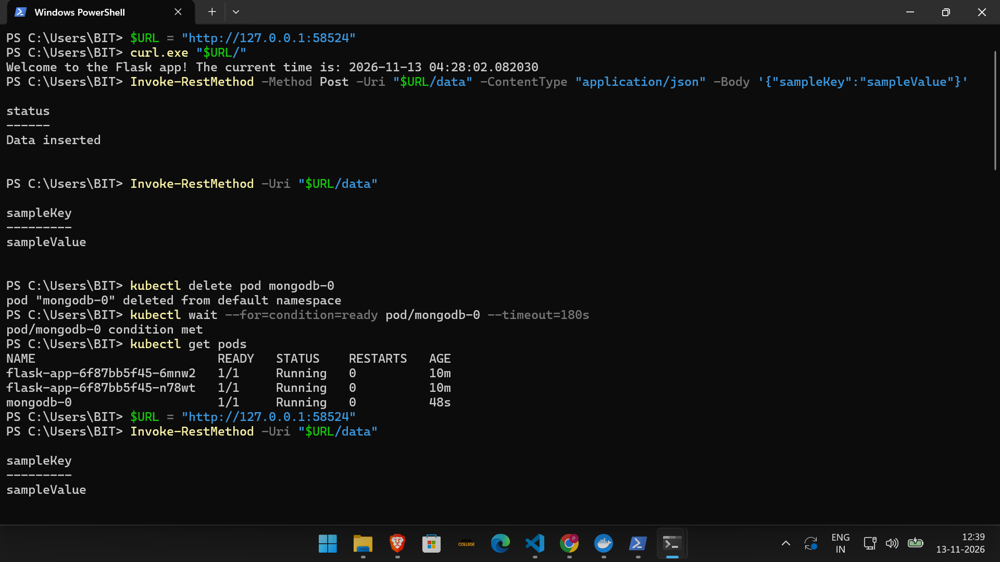
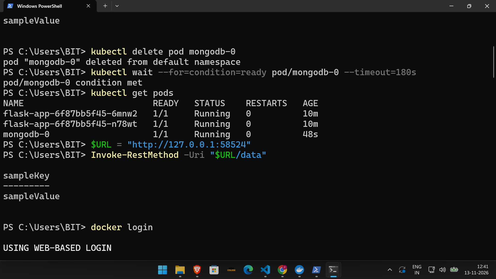
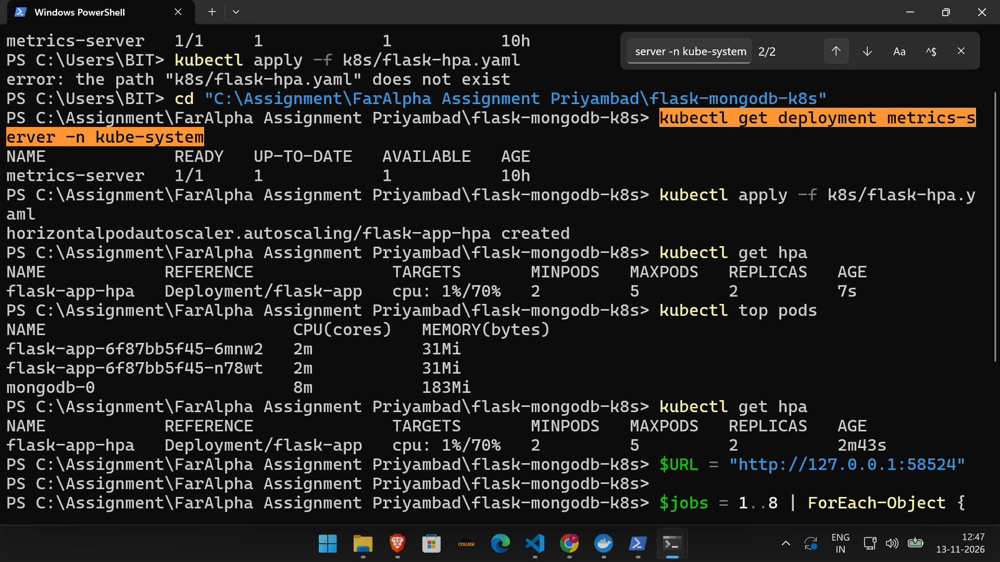
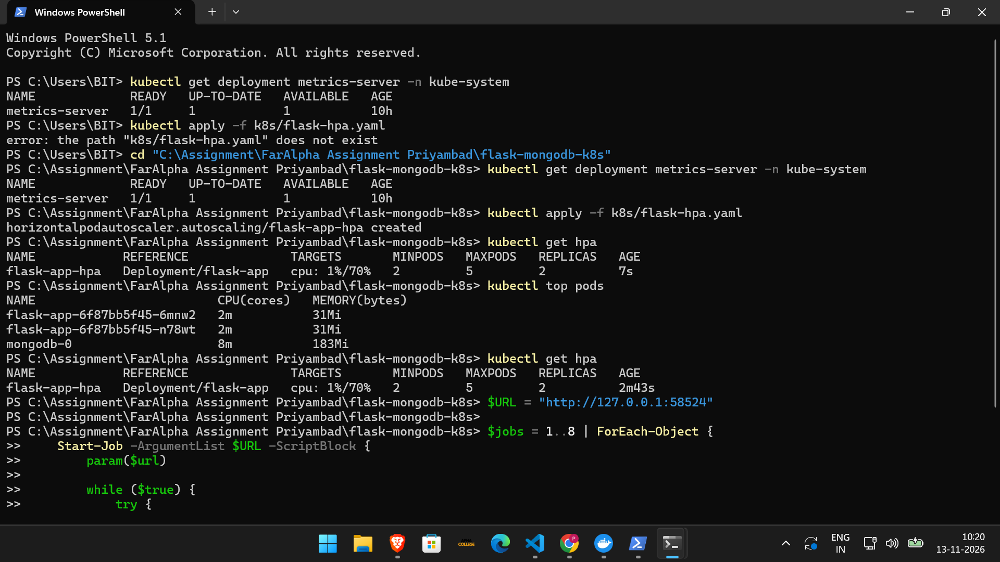
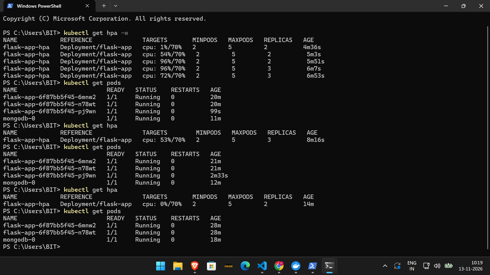

# Flask and MongoDB Deployment on Kubernetes

## 1. Project Overview

This project demonstrates deploying a Flask REST API connected to MongoDB using Kubernetes and Minikube.

I implemented containerization, persistent database storage, Kubernetes configuration management, resource requests and limits, and CPU-based Horizontal Pod Autoscaling (HPA).

## 2. Technology Stack

| Technology | Purpose |
|---|---|
| Python and Flask | REST API |
| MongoDB 7.0 | Database |
| PyMongo | MongoDB connectivity |
| Docker | Containerization |
| Kubernetes | Container orchestration |
| Minikube | Local Kubernetes cluster |
| kubectl | Kubernetes management |
| Docker Hub | Container image registry |

## 3. How I Completed the Assessment

### Step 1: Created the Flask Application

First, I created a Flask application with three REST API endpoints:

- `GET /` – Returns a welcome message and current application time.
- `POST /data` – Inserts JSON data into MongoDB.
- `GET /data` – Retrieves stored data from MongoDB.

I used PyMongo to connect Flask with MongoDB.

### Step 2: Built the Docker Image

Next, I created a Dockerfile using Python 3.12 slim, installed the required dependencies, and built the application image.

```powershell
docker build -t flask-mongodb-app:v1 .
```

### Step 3: Pushed the Docker Image to Docker Hub

I logged in to Docker Hub, tagged the image with my Docker Hub username, and pushed it to the registry.

```powershell
docker login
docker tag flask-mongodb-app:v1 priyambaddubey/flask-mongodb-app:v1
docker push priyambaddubey/flask-mongodb-app:v1
```

**Docker Hub Image:** `priyambaddubey/flask-mongodb-app:v1`



### Step 4: Created the Minikube Kubernetes Cluster

I started Minikube using the Docker driver.

```powershell
minikube start --driver=docker --cpus=2 --memory=2048
```

I then created Kubernetes configuration files for the Flask Deployment, MongoDB StatefulSet, Services, ConfigMap, Secret, PersistentVolume, PersistentVolumeClaim, and HPA.

### Step 5: Deployed the Kubernetes Resources

I applied the Kubernetes configuration files.

```powershell
kubectl apply -f .\k8s\
```

I configured the Flask Deployment to use the Docker Hub image and verified the rollout.

```powershell
kubectl rollout status deployment/flask-app
```



### Step 6: Configured MongoDB Persistent Storage

I created a 1Gi PersistentVolume and PersistentVolumeClaim with `ReadWriteOnce` access.

I mounted the PVC at `/data/db` in the MongoDB StatefulSet.

I verified the storage configuration.

```powershell
kubectl get pv,pvc
```



### Step 7: Verified Kubernetes Pods and Services

I checked the Flask and MongoDB Pods and verified their Services.

```powershell
kubectl get pods
kubectl get svc
```

The Flask application used a NodePort Service, and MongoDB used an internal ClusterIP Service.



### Step 8: Accessed the Flask Application

I exposed the Flask application through the NodePort Service and generated a local Minikube URL.

```powershell
minikube service flask-service --url
```



### Step 9: Tested Flask API and MongoDB

I tested the Flask welcome endpoint, inserted sample JSON data into MongoDB, and retrieved the stored data.



### Step 10: Verified MongoDB Persistence

I inserted data, deleted the MongoDB Pod, and waited for the StatefulSet to recreate it.

I retrieved the previously inserted data again to verify that it remained available after Pod recreation.



### Step 11: Configured Metrics Server and HPA

I verified the Metrics Server and configured HPA with a minimum of 2 replicas, a maximum of 5 replicas, and a CPU utilization target of 70%.

```powershell
kubectl get deployment metrics-server -n kube-system
kubectl apply -f k8s/flask-hpa.yaml
kubectl get hpa
kubectl top pods
```



### Step 12: Generated Load for Autoscaling

I started eight PowerShell background jobs to continuously send HTTP requests to the Flask application and generate CPU load.

I stopped and removed the jobs after the test.



### Step 13: Verified HPA Scale-Up and Scale-Down

During the load test, CPU utilization increased to 96%, and HPA scaled the Flask replicas from 2 to 3.

After stopping the load generator, CPU utilization decreased to 0%, and HPA scaled the replicas back from 3 to 2.




## 4. Final Results

- Flask REST API connected successfully to MongoDB.
- Docker image pushed to Docker Hub.
- Kubernetes Deployment and MongoDB StatefulSet deployed.
- Persistent storage configured and tested.
- Flask and MongoDB Services configured.
- ConfigMap and Secret configured.
- Resource requests and limits configured.
- Metrics Server and HPA configured.
- HPA scaled Flask replicas from 2 to 3 and back to 2.
- MongoDB data remained available after Pod recreation.