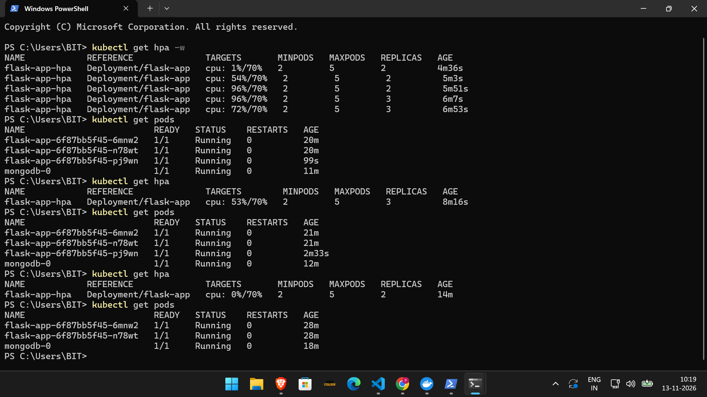
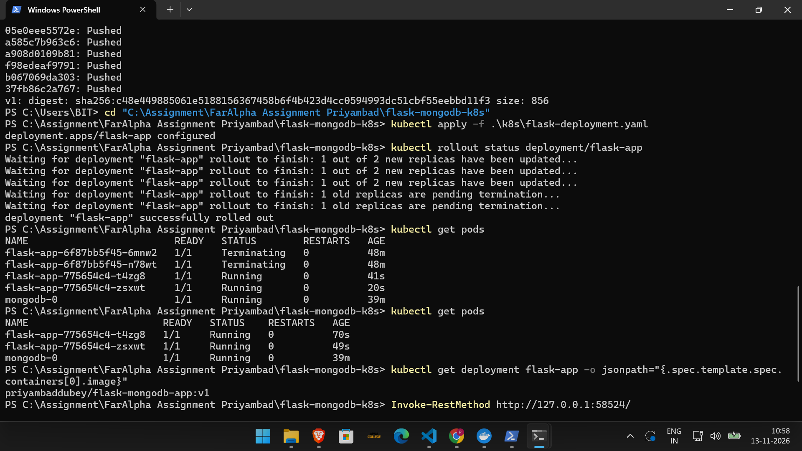
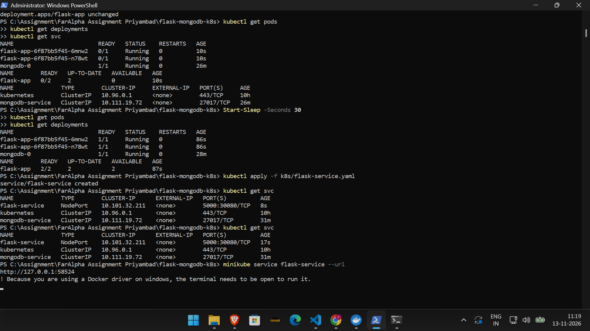

# Testing Evidence

## 1. HPA Scale-Up Test

The CPU utilization increased to 96%, and HPA scaled the Flask replicas from 2 to 3.

## 2. HPA Scale-Down Test

After stopping the load generator, CPU utilization reduced and HPA scaled replicas from 3 to 2.

## 3. Docker Hub Deployment

The Kubernetes Deployment successfully used the Docker Hub image.

## 4. Flask Application Access

The Flask application was accessed successfully through the Minikube service URL.

## 5. MongoDB Persistence Test

Previously inserted data remained available after MongoDB Pod recreation.